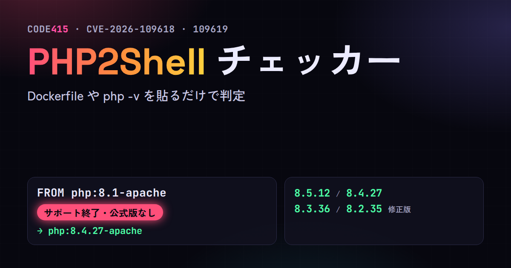

# PHP2Shell Check

Paste a Dockerfile, docker-compose, `php -v`, phpinfo or a package list and see whether your PHP needs the October 2026 fix for **CVE-2026-109618** and **CVE-2026-109619**, the two critical PHP remote code execution bugs people call PHP2Shell.

**Try it:** https://code415.dev/demos/2026-10-22/php2shell-check



It only reads the text you paste. It never connects to your servers or anywhere else. No dependencies, one JavaScript file.

## What it reads

| Input | Example |
| --- | --- |
| Dockerfile and compose files | `FROM php:8.1-apache`, `image: php:8.3-fpm-alpine`, `image: wordpress:6.6-php8.2-apache` |
| `php -v` | `PHP 8.4.27 (cli) (built: ...)` |
| phpinfo | `PHP Version => 8.2.20` with `Server API => FPM/FastCGI` |
| HTTP headers | `X-Powered-By: PHP/7.4.33` |
| Debian, Ubuntu and RPM package lists | `ii libapache2-mod-php8.1 8.1.2-1ubuntu2.19`, `php-fpm-8.0.30-1.el9` |
| CI and composer | `php-version: '8.1'`, `"php": "^8.1"` |
| Plain server lists | `web02 PHP 7.2.34 apache mod_php` |

For each PHP it finds, it says whether it is fixed, needs a pull and rebuild, needs a vendor check, needs an update, or is end of life, how PHP runs there (mod_php, PHP-FPM, php-cgi, FrankenPHP, LiteSpeed, CLI), and what to move to.

## The facts it uses

From the PHP security advisory of 21 October 2026:

- Fixed in **8.5.12, 8.4.27, 8.3.36 and 8.2.35**. PHP 8.6.0 RC4 also has the fixes.
- At risk: every PHP installation serving web requests, including PHP-FPM, Apache with mod_php, php-cgi, FrankenPHP and LiteSpeed. PHP considers the risk highest for mod_php, with a demonstrated exploit where an unauthenticated request triggers the attack before any application code runs.
- 8.1 and older get no release. The PHP team published minimal source backports for 7.4, 8.0 and 8.1. Distributions and LTS vendors received the patches in advance.
- Updating is the only complete fix.

Official Docker images: the 8.2 to 8.5 tags on Docker Hub point to the fixed versions, published on 2026-10-21 between 16:47 and 17:31 UTC for amd64, arm64 and most other platforms. Floating tags like `php:8.3-apache` are fine after you pull, rebuild and replace your containers. Run `php -v` inside a container to confirm, and pin exact tags such as `php:8.3.36-apache` if you want the version to be explicit.

## Command line

```sh
npx github:guoziyu415/php2shell-check Dockerfile docker-compose.yml
php -v | npx github:guoziyu415/php2shell-check
dpkg -l | grep php | npx github:guoziyu415/php2shell-check --lang en
```

Exit code 1 when something needs action. `--json` for machine readable output.

## What it cannot tell you

It compares versions and modes with the advisory. It cannot tell whether you were attacked or whether a server is compromised. Distribution packages keep the upstream version number, so confirm with your vendor's security tracker.

## 日本語

Dockerfile、docker-compose、php -v、phpinfo、パッケージ一覧を貼るだけで、PHP2Shell と呼ばれる CVE-2026-109618 と CVE-2026-109619 の修正が必要か判定します。修正版は 8.5.12、8.4.27、8.3.36、8.2.35。8.1 以前は公式の修正版が出ません。mod_php は PHP 公式が最も危険と見ている方式です。貼った文字を読むだけで、サーバーには一切アクセスしません。

## Sources

- PHP security advisory, 21 Oct 2026: https://www.php.net/
- GHSA-w8hw-w9fx-j79w: https://github.com/php/php-src/security/advisories/GHSA-w8hw-w9fx-j79w
- GHSA-6wmf-4rv5-p3rp: https://github.com/php/php-src/security/advisories/GHSA-6wmf-4rv5-p3rp
- Help Net Security: https://www.helpnetsecurity.com/2026/10/21/php2shell-php-vulnerabilities-patched-cve-2026-109618-cve-2026-109619/
- Huntress: https://www.huntress.com/blog/php2shell-leaked-critical-php-vulnerabilities
- docker-library/php versions: https://github.com/docker-library/php/blob/master/versions.json

## License

MIT. Made by Ziyu Guo, [@Code415zg](https://x.com/Code415zg), [code415.dev](https://code415.dev).
